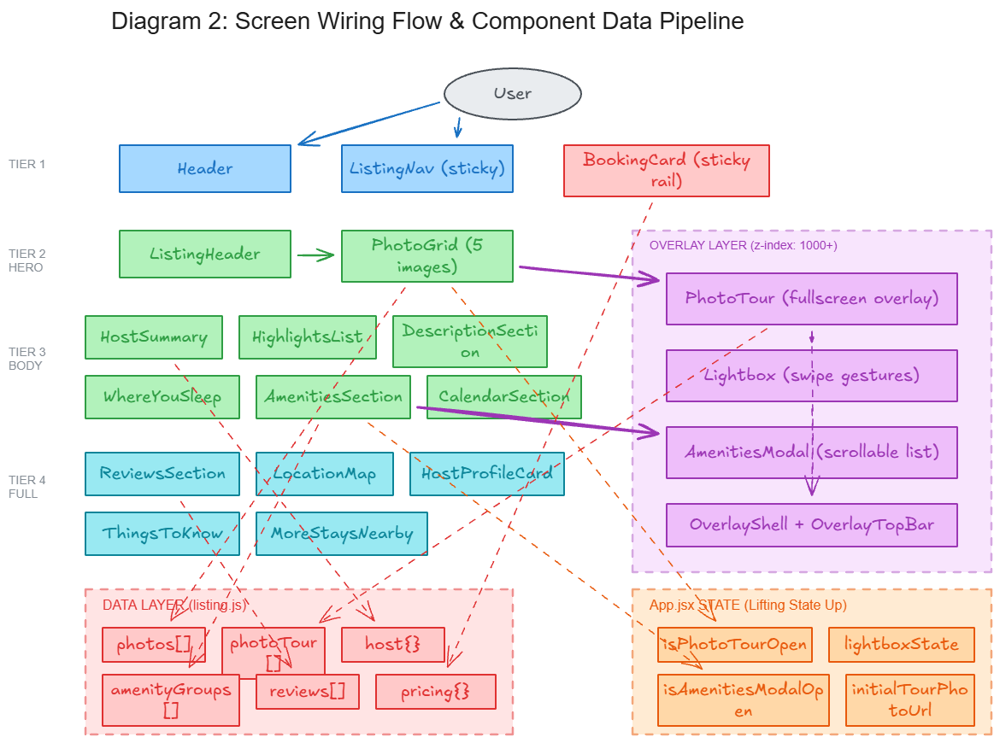

# Airbnb Clone: Luxury Listing Page

A pixel-perfect, highly interactive, and responsive React clone of the Airbnb listing page. This project focuses on delivering a premium user interface with smooth animations, dynamic overlays, and a sophisticated component architecture.

## Architecture Diagrams

### Diagram 1: Folder Architecture & Component-Hook Connections
> Color-coded map of every folder, component, and React Hook in the project with their data-flow connections.


### Diagram 2: Screen Wiring Flow & Component Data Pipeline
> Tiered view of the full page layout showing how user interactions flow through components into overlays, and how data from `listing.js` feeds each section.



## 1. Tech Stack

*   **Core**: React 18
*   **Build Tool**: Vite
*   **Styling**: Tailwind CSS (with arbitrary values and custom utility classes)
*   **Animations**: Framer Motion (for Lightbox gestures, modal transitions, and layout animations)
*   **Icons**: Custom inline SVGs closely matching Airbnb's design system
*   **Data Management**: Local JSON structure simulating a REST API response

## 2. Approach & Architecture

The application is built using a **Component-Driven Architecture**. The layout is divided into highly modular, single-responsibility components. 

*   **Data-Driven Design**: The entire UI is populated by a single source of truth (`src/data/listing.js`), making the components reusable and agnostic to the data they display.
*   **Progressive Disclosure**: Information is heavily structured. Summaries are shown on the main page, and detailed information is progressively disclosed through complex overlays (Modals, Photo Tours, Lightboxes).
*   **Responsive Grid Systems**: Tailwind's CSS Grid and Flexbox are used extensively to handle the complex two-column layout (Main Content + Sticky Booking Card) that degrades gracefully into a single column on smaller screens.
*   **Custom Scroll Behaviors**: Horizontal scrolling containers without visible scrollbars (`no-scrollbar`) and smooth anchor scrolling are implemented natively using CSS and JavaScript.

## 3. Detailed Folder Architecture

```text
airbnb-clone/
├── public/                 # Static assets (images, icons)
├── src/
│   ├── assets/             # Bundled SVGs and images
│   ├── components/
│   │   ├── booking/        # Components related to reservation (BookingCard)
│   │   ├── layout/         # Shell components (Header, ListingNav)
│   │   ├── listing/        # Page sections (Hero, Host, Amenities, Map, etc.)
│   │   └── overlays/       # Full-screen Modals (PhotoTour, Lightbox)
│   ├── data/               # Mock data (listing.js)
│   ├── App.jsx             # Main Application entry point & State Manager
│   ├── index.css           # Global styles and Tailwind directives
│   └── main.jsx            # React DOM rendering
├── tailwind.config.js      # Tailwind configuration
└── package.json
```

## 4. State Management and React Hooks

The application heavily utilizes React Hooks to manage complex UI interactions without relying on external state libraries like Redux.

### `useState`
*   **Modals:** `isAmenitiesModalOpen`, `isPhotoTourOpen`, `lightboxState` in `App.jsx` control the visibility of full-screen overlays.
*   **UI State:** `activeCategory` in `PhotoTour` and `ListingNav` tracks which section the user is currently viewing.
*   **Component Logic:** `currentPage` in `MoreStaysNearby` tracks carousel pagination.

### `useEffect`
*   **Scroll Tracking:** Used in conjunction with `IntersectionObserver` in `ListingNav` and `PhotoTour` to automatically update the active navigation tab based on the user's scroll position.
*   **Event Listeners:** Binds `keydown` events for keyboard navigation (Escape to close, Arrow keys to navigate) inside the `Lightbox`.
*   **DOM Manipulation:** Manages locking and unlocking the `body` scroll when overlays are opened to prevent background scrolling.
*   **Auto-scrolling:** Triggers `scrollIntoView` when the Photo Tour opens to jump directly to the specific image a user clicked.

### `useRef`
*   **DOM Access:** `scrollContainerRef` in `MoreStaysNearby` allows programmatic horizontal scrolling via buttons.
*   **Observer Targets:** `categoriesRef` stores an array of DOM nodes for the Intersection Observer to watch (used in `PhotoTour`).

### `useMemo`
*   **Performance Optimization:** Used in `PhotoTour` to flatten the nested category photos array (`flatPhotos`) into a single array for the Lightbox index, preventing unnecessary recalculations on every render.

## 5. Component Connection & Code Walkthrough

### The Orchestrator: `App.jsx`
`App.jsx` acts as the master controller. It fetches data from `listing.js` (implicitly via imports) and renders the layout sequentially. It holds the state for all major overlays and passes down setter functions as props (e.g., `onOpenTour`, `onOpenModal`).

### Phase 1: Navigation & Shell (`layout/`)
*   **`Header.jsx`**: The static global top bar with the Airbnb logo and search bar.
*   **`ListingNav.jsx`**: A sticky secondary navigation bar. It uses an Intersection Observer to watch IDs (`#photos`, `#amenities`, `#reviews`, `#location`) in `App.jsx` and highlights the active link.

### Phase 2: Hero Section (`listing/`)
*   **`ListingHeader.jsx`**: Displays the title and quick stats.
*   **`PhotoGrid.jsx` & `PhotoGridTile.jsx`**: Renders the 5-image mosaic. When a tile is clicked, it identifies the specific photo and calls `openPhotoTour(photo)` back in `App.jsx`.

### Phase 3 & 4: The Main Grid (`listing/` & `booking/`)
The main body is wrapped in a `grid lg:grid-cols-[1fr_370px]`.
*   **Left Column**: A vertical stack of informational components (`HostSummary`, `HighlightsList`, `WhereYouSleepSection`, `AmenitiesSection`). These are purely presentational, reading data and rendering UI.
*   **Right Column**: **`BookingCard.jsx`** sits in a `sticky` container. It handles its own internal layout for pricing, date selection, and the prominent "Reserve" button.

### Phase 5: Full Width Sections (`listing/`)
Once past the sticky booking card, the layout expands to full width.
*   **`ReviewsSection.jsx`**: Features a horizontally scrolling category pill list and user review cards.
*   **`LocationMap.jsx`**: A custom-built CSS visualization of a map using precise absolute positioning, simulating a real interactive map.
*   **`HostProfileCard.jsx`**: A highly stylized component featuring a prominent shadow card, SVG balloon icons, and a grid of `CoHost` sub-components.
*   **`ThingsToKnow.jsx` & `MoreStaysNearby.jsx`**: Additional footer information, including a custom horizontal carousel with `<` and `>` button controls.

### Phase 6: Overlays (`overlays/`)
These components render conditionally over the main application.
*   **`OverlayShell.jsx`**: A reusable wrapper that provides the fade-in animation and z-index context.
*   **`PhotoTour.jsx`**: A complex scrolling modal. It features a sticky horizontal category navigation, a masonry-style 8-column CSS grid for images, and complex scroll-to-element logic.
*   **`Lightbox.jsx`**: Triggered from inside the Photo Tour. It uses `framer-motion` for fluid swipe gestures (`drag="x"`), image zooming, and seamless transitions between photos.

---

*This README was generated to provide a comprehensive architectural overview of the Airbnb clone project.*
